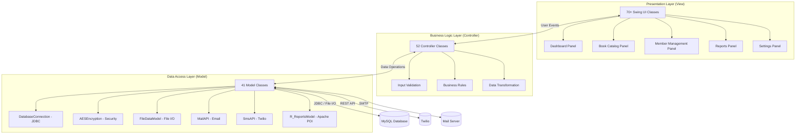
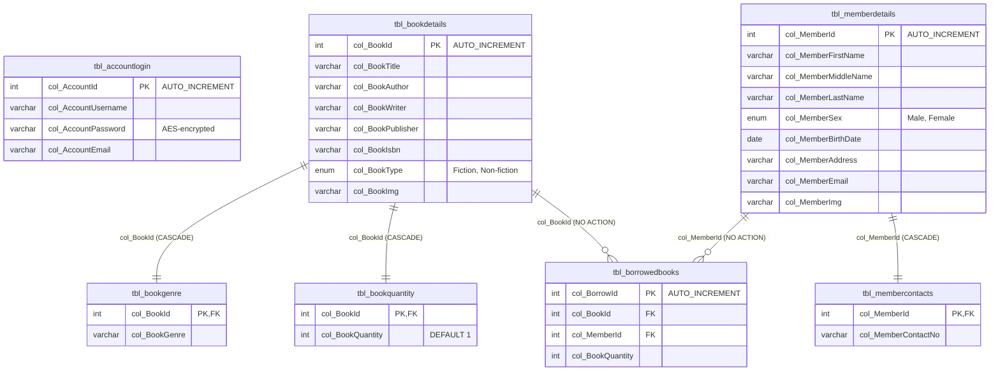

<div align="center">


# Libranix — Library Management System

**A full-featured, cross-platform desktop application for library automation built with Java Swing, MySQL, and MVC architecture.**

[](https://www.java.com/)
[](https://docs.oracle.com/javase/tutorial/uiswing/)
[](https://www.mysql.com/)
[](LICENSE)
[](#-architecture)
[](#-cross-platform-compatibility)

</div>

---

## 📖 Table of Contents

- [Overview](#-overview)
- [Features](#-features)
- [Architecture](#-architecture)
- [Technology Stack](#-technology-stack)
- [Database Schema](#-database-schema)
- [Security](#-security)
- [Cross-Platform Compatibility](#-cross-platform-compatibility)
- [Project Structure](#-project-structure)
- [Getting Started](#-getting-started)
- [Screenshots](#-screenshots)
- [Contributing](#-contributing)
- [License](#-license)

---

## 🚀 Overview

**Libranix** is an enterprise-grade **Library Management System (LMS)** desktop application designed to streamline library operations including book cataloging, member administration, borrowing/return tracking, and analytics reporting. Built with a rigorous **Model-View-Controller (MVC)** architecture, it separates business logic from presentation, ensuring maintainability and scalability.

The application targets **Java SE 8+** runtimes and uses **MySQL** for persistent storage, **AES-128 encryption** for credential security, and integrates with **Twilio** and **JavaMail** for multi-channel member communications. Report generation leverages **Apache POI** and **JFreeChart** for professional `.docx` exports with embedded data visualizations.

> **Keywords**: Library Management System, LMS, Java Desktop Application, Swing GUI, MySQL JDBC, MVC Architecture, AES Encryption, Apache POI Reports, JFreeChart Analytics, Twilio SMS Integration, JavaMail Email, Cross-Platform Java App, Book Inventory Management, Member Management System, Borrow Return Tracking

---

## ✨ Features

### 🔐 Authentication & Security
- **AES-128 Encrypted Login** — Passwords encrypted with a 128-bit AES key stored in a local hex-encoded file (`Libranix.data`)
- **Password Reset Flow** — Forgot-password workflow with 4-digit security code delivered via email
- **Role-Based Access** — Admin and Librarian login modes
- **Encrypted Configuration** — All sensitive settings (SMTP credentials, Twilio tokens) stored as individual AES-encrypted files
- **Cross-Platform Database Config** — MySQL connection parameters externalized to `data/db.properties`

### 📚 Book Catalog Management
- **Add Books** — Full bibliographic metadata: Title, Author, Writer, Publisher, ISBN, Genre (26 fiction + 22 non-fiction categories), Type, Quantity, Cover Image
- **Edit Books** — Modify any book attribute with real-time table search and selection
- **Delete Books** — Cascading delete with foreign-key-aware integrity checks
- **Search Books** — Multi-field search with case-insensitive matching
- **View Books** — Sortable, scrollable table with detail drill-down card

### 👥 Member Management
- **Add Members** — Comprehensive profile: Name, Sex, Birth Date, Address, Email, Phone, Photo
- **Edit Members** — Update member details with indexed table lookup
- **Delete Members** — Constraint-safe removal with borrow-history validation
- **Search Members** — Full-text search across member records
- **View Members** — Paginated member directory with contact details
- **Remind Members** — **Multi-channel notifications** via SMS (Twilio) and Email (JavaMail) for overdue books

### 📖 Borrowing & Returns
- **Borrow Books** — Link books to members with quantity tracking; automatic inventory decrement
- **Return Books** — Process returns with automatic quantity restoration
- **Borrow History** — Full transaction log with composite-key junction table
- **Inventory Management** — Real-time quantity synchronization with FK constraints

### 📊 Analytics & Reporting
- **Dashboard** — At-a-glance total books and members counts with quick-action buttons
- **Charts** — 4 JFreeChart visualizations: Books vs Members (Pie), Borrowed Totals (Bar), Inventory Levels (Bar), Most Popular Books (Pie)
- **Report Generation** — **Apache POI** `.docx` export with embedded chart images, formatted headers, and librarian notes footer
- **Request Notes** — Persisted librarian annotations for report appendices

### ⚙️ Settings & Configuration
- **Security Settings** — Change admin email and password with verification
- **Mailer Settings** — Configure SMTP (host, port, credentials) for email delivery
- **Sender Settings** — Configure Twilio (Account SID, Auth Token, Phone Number) for SMS
- **Persistent Preferences** — All settings encrypted and persisted across sessions

### 🎨 User Experience
- **Custom Window Chrome** — Undecorated frames with custom draggable title bars, minimize/close buttons
- **Consistent Theme** — Cornflower blue / Dodger blue color palette with Lucida Sans typography
- **Icon-Driven Navigation** — Sidebar with 32+ custom icons for each operation
- **Custom Form Components** — 16 specialized validated text fields with placeholder behavior
- **Modal Dialogs** — Contextual confirm, error, message, input, and password dialogs
- **Card-Based Layout** — `CardLayout` navigation for zero-lag panel switching

---

## 🏗 Architecture

Libranix follows a strict **three-tier MVC (Model-View-Controller)** architecture:



### Layer Responsibilities

| Layer | Package | Count | Responsibility |
|-------|---------|-------|----------------|
| **View** | `src/view/` | 70+ | Swing GUI components: frames, panels, dialogs, custom components, form fields, table cards |
| **Controller** | `src/controller/` | 52 | Mediates view ↔ model; input validation via regex; business logic orchestration; data transformation |
| **Model** | `src/model/` | 41 | Data persistence (JDBC, File I/O); AES encryption; external API integration (Twilio, JavaMail); report generation (Apache POI) |

### Navigation Flow

```
LoginFrame ──authenticate──▶ MainWindow
                                │
                    ┌───────────┼───────────┬───────────┐
                    ▼           ▼           ▼           ▼
              Dashboard   BookCatalog  MemberMgmt   Reports
                    │           │           │           │
              ┌─────┤      ┌────┤      ┌────┤           │
              ▼     ▼      ▼    ▼      ▼    ▼           ▼
            View  About   Add  Edit   Add  Edit     Charts + Export
           Books          Del  Search  Del  Search
           Members        Brw  View   View Remind
                          Ret
```

### Key Design Patterns

| Pattern | Implementation |
|---------|---------------|
| **MVC** | Strict separation: Views never access Models directly; Controllers mediate all interactions |
| **Singleton** | `DatabaseConnection` connection management; shared `AESEncryption` key |
| **Observer** | Swing event listeners (`ActionListener`, `MouseAdapter`) for UI interaction |
| **Strategy** | `InputValidator` regex patterns for field-level validation strategies |
| **Factory** | `FileDataModel` creates genre/type/sex data arrays from property files |
| **DAO** | Models act as Data Access Objects, encapsulating all SQL and file operations |

---

## 💻 Technology Stack

### Core
| Technology | Version | Purpose |
|------------|---------|---------|
| **Java** | SE 8+ | Core language and runtime |
| **Java Swing** | — | Desktop GUI framework |
| **JDBC** | — | Database connectivity |
| **MySQL** | 5.5+ | Relational database |
| **Javax.Crypto** | — | AES-128 encryption |

### Libraries (25 JARs)
| Library | Version | Purpose |
|---------|---------|---------|
| **MySQL Connector/J** | 8.0.26 | JDBC driver for MySQL |
| **Apache POI** | 4.1.2 | `.docx` report generation (XWPFDocument) |
| **JFreeChart** | 1.5.0 | Pie & bar chart visualizations |
| **Twilio SDK** | 7.0.0 | SMS notifications |
| **JavaMail** | 1.6.2 | SMTP email delivery |
| **Apache Commons Codec** | 1.13 | Hex encoding/decoding for AES keys |
| **Apache Commons Collections** | 4.4 | POI dependency |
| **Apache Commons Compress** | 1.19 | POI dependency |
| **Apache Commons Logging** | 1.2 | POI dependency |
| **Apache Commons Math** | 3.6.1 | POI dependency |
| **JAXB** | 2.3.x | XML binding (POI dependency) |
| **XMLBeans** | 3.1.0 | POI OOXML schema handling |
| **Log4j** | 1.2.17 | Application logging |
| **JUnit** | 4.12 | Unit testing |

---

## 🗄 Database Schema

**Database Name**: `librarydatabase`  
**Engine**: InnoDB (MySQL 5.5+)  
**Character Set**: UTF-8



### Table Summary

| Table | Rows (Sample) | Description |
|-------|---------------|-------------|
| `tbl_accountlogin` | 1 | Admin credentials (created at setup) |
| `tbl_bookdetails` | 18 | Book bibliographic metadata |
| `tbl_bookgenre` | 18 | Genre classification per book |
| `tbl_bookquantity` | 18 | Inventory count per book |
| `tbl_memberdetails` | 7 | Member profiles |
| `tbl_membercontacts` | 7 | Member phone numbers |
| `tbl_borrowedbooks` | 13 | Active & historical borrow records |

---

## 🔒 Security

### AES-128 Encryption Architecture

```
┌─────────────────────────────────────────────────────┐
│                  Key Generation                       │
│  MainTest.java → KeyGenerator("AES", 128-bit)        │
│  → encodeHex() → data/Libranix.data                  │
└──────────────────────┬──────────────────────────────┘
                       │
                       ▼
┌─────────────────────────────────────────────────────┐
│                  Encryption Flow                      │
│  plaintext → Cipher.init(ENCRYPT_MODE, key)          │
│  → doFinal(bytes) → Base64.encode() → ciphertext     │
└──────────────────────┬──────────────────────────────┘
                       │
                       ▼
┌─────────────────────────────────────────────────────┐
│              Login Verification                       │
│  User Input → encrypt with stored key                │
│  → Arrays.equals(storedEncrypted, inputEncrypted)    │
└─────────────────────────────────────────────────────┘
```

### Protected Assets
- Login password → stored encrypted in `tbl_accountlogin`
- SMTP credentials → 4 individual AES-encrypted files
- Twilio credentials → 3 individual AES-encrypted files
- All settings data → encrypted at rest

---

## 🌍 Cross-Platform Compatibility

Libranix is designed for **environment-agnostic execution** across Windows, macOS, and Linux:

| Feature | Implementation |
|---------|---------------|
| **File Paths** | All paths use `java.io.File(parent, child)` constructor — zero hardcoded `/` or `\` separators |
| **Database Config** | Externalized to `data/db.properties` — edit one file to change host, port, credentials |
| **Line Endings** | Java's `System.lineSeparator()` and platform-agnostic `BufferedReader`/`BufferedWriter` |
| **Image Resources** | Classpath-loaded via `Class.getResource()` — works on any JVM |
| **Report Output** | Timestamped `.docx` exports via Apache POI — no OS-specific paths |
| **JVM Target** | Java SE 8 bytecode — runs on any Java 8+ runtime |

---

## 📁 Project Structure

```
Libranix--A-Library-Management-System/
├── src/
│   ├── MainClass.java                    # Application entry point
│   ├── controller/                       # 52 controllers (business logic)
│   │   ├── LoginController.java
│   │   ├── AddBkFormController.java
│   │   ├── AddMbrFormController.java
│   │   ├── BorrowBkTransactController.java
│   │   ├── InputValidator.java
│   │   └── ... (47 more)
│   ├── model/                            # 41 models (data access)
│   │   ├── DatabaseConnection.java       # JDBC connection manager
│   │   ├── AESEncryption.java            # AES-128 crypto engine
│   │   ├── MailAPI.java                  # JavaMail integration
│   │   ├── SmsAPI.java                   # Twilio integration
│   │   ├── R_ReportsModel.java           # Apache POI report generator
│   │   ├── SetupUtility.java             # One-time DB setup
│   │   └── ... (35 more)
│   ├── view/                             # 70+ views (Swing UI)
│   │   ├── LoginFrame.java
│   │   ├── MainWindow.java
│   │   ├── BorderWindow.java             # Custom window chrome
│   │   ├── CustomChart.java              # JFreeChart wrapper
│   │   ├── Img.java                      # Image display & chooser
│   │   ├── Table.java                    # Styled JTable
│   │   └── ... (65+ more)
│   ├── props/                            # Static data files
│   │   ├── fictionGenre.data
│   │   ├── nonfictionGenre.data
│   │   ├── sex.data
│   │   └── ...
│   └── res/                              # UI icons (32+ PNGs)
├── data/                                 # Runtime data & config
│   ├── db.properties                     # MySQL connection config
│   ├── Libranix.data                     # AES encryption key
│   ├── Data_0ME.data ~ Data_6PN.data     # Encrypted credentials
│   └── requests.data                     # Librarian notes
├── resource/                             # Placeholder images
│   ├── Book.png
│   ├── Member.png
│   └── error.png
├── images/                               # Uploaded book/member images
├── lib/                                  # 25 external JAR dependencies
├── Dump20200904.sql                      # Database schema & sample data
├── .classpath                            # Eclipse project config
└── README.md
```

---

## 🚦 Getting Started

### Prerequisites
- **Java Development Kit (JDK)** 8 or later
- **MySQL Server** 5.5 or later
- **Eclipse IDE** (optional — project includes `.classpath` and `.project` files)

### Step 1: Clone & Import Database

```bash
git clone https://github.com/your-org/Libranix--A-Library-Management-System.git
cd Libranix--A-Library-Management-System
```

Import the database schema and sample data:
```bash
mysql -u root -p < Dump20200904.sql
```

### Step 2: Configure Database Connection

Edit `data/db.properties` to match your MySQL setup:
```properties
db.url=jdbc:mysql://localhost:3306/librarydatabase?useSSL=false&allowPublicKeyRetrieval=true&serverTimezone=UTC
db.user=root
db.password=your_password_here
```

### Step 3: Generate AES Key & Admin Account

Compile and run the setup utility:
```bash
# Compile (adjust paths to your JDK)
javac -cp "lib/*;bin" -d bin src/model/SetupUtility.java

# Run
java -cp "lib/*;bin" model.SetupUtility
```

This will:
- Read or create the AES encryption key in `data/Libranix.data`
- Create the `tbl_accountlogin` table
- Insert default admin credentials: **`admin` / `admin`**

### Step 4: Launch the Application

```bash
java -cp "lib/*;bin" MainClass
```

Or open the project in **Eclipse** and run `MainClass.java` directly.

### Default Login
```
Username: admin
Password: admin
```

---

## 📸 Screenshots

> *Screenshots of the application interface would be placed here.*

| Screen | Description |
|--------|-------------|
| Login | Custom undecorated login window with forgot-password flow |
| Dashboard | Book & member counts with quick-action navigation |
| Book Catalog | Add, Edit, Delete, Search, Borrow, Return, View books |
| Member Management | Add, Edit, Delete, Search, View, Remind members |
| Reports | JFreeChart analytics with Apache POI .docx export |
| Settings | Security, Mailer, and Sender configuration panels |

---

## 🤝 Contributing

Contributions are welcome! Please follow these guidelines:

1. **Fork** the repository
2. **Create** a feature branch (`git checkout -b feature/amazing-feature`)
3. **Commit** your changes (`git commit -m 'Add amazing feature'`)
4. **Push** to the branch (`git push origin feature/amazing-feature`)
5. **Open** a Pull Request

### Code Style
- Follow existing MVC patterns — new features should have View, Controller, and Model classes
- Use `java.io.File(parent, child)` for all file paths (cross-platform compatibility)
- Externalize configuration to `data/db.properties` or encrypted data files
- Validate all user input through `InputValidator` regex patterns

---

## 📄 License

This project is licensed under the MIT License — see the [LICENSE](LICENSE) file for details.

---

<div align="center">

**Built with ❤️ using Java Swing, MySQL, and MVC Architecture**

[⬆ Back to Top](#libranix--library-management-system)
 
</div>
